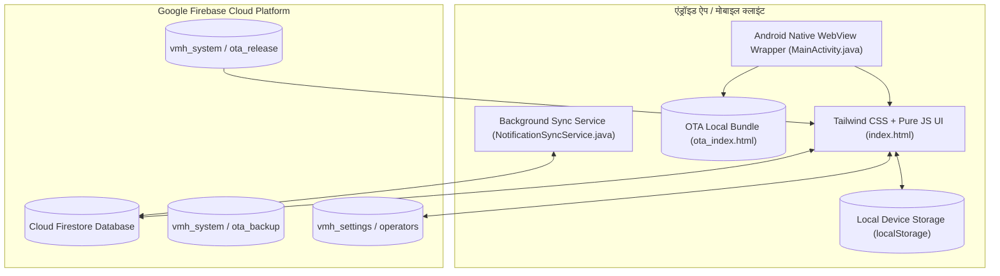

# 🏛️ वर्मा मैरिज हॉल (Verma Marriage Hall) - Complete Project Documentation (AI.md)

> **प्रोजेक्ट:** वर्मा मैरिज हॉल - डिजिटल प्रबंधन, रसीद बिलिंग एवं बुकिंग प्रणाली  
> **स्थान:** ग्राम असनहरा, निकट अंकित धर्मकांटा, जिला बस्ती, उत्तर प्रदेश - 272194  
> **संपर्क:** 9918802425, 9936435350  
> **वर्तमान सॉफ्टवेयर वर्जन:** `v1.3` (OTA Engine Bulletproof Asset Resolver, Native Interception & Zero-Distortion UI)  
> **टारगेट प्लेटफॉर्म:** Android 8.0+ (API 26+) & Modern Web Browsers  

---

## 🌟 1. प्रोजेक्ट विजन एवं उद्देश्य (Project Vision)
वर्मा मैरिज हॉल का उद्देश्य पारंपरिक कागज़ी बही-खातों और रसीद कट्टों को हटाकर एक आधुनिक, सरल, तेज़ और 100% विश्वसनीय डिजिटल समाधान तैयार करना है जिसे परिवार के वरिष्ठ सदस्य (पापा जी) भी बिना किसी तकनीकी उलझन के आसानी से चला सकें।
- **शून्य डेटा हानि (Zero Data Loss):** इंटरनेट न होने (ऑफलाइन) पर भी हर बुकिंग सुरक्षित रहे।
- **पारंपरिक रसीद (Authentic Slip):** भारतीय वैवाहिक रसीदों जैसी सुंदर, स्पष्ट और प्रामाणिक रसीद (श्री गणेशाय नमः, बर्तन व सामान सूची, सुविधाएं, नियम व शर्तें)।
- **ऑटोमैटिक साइलेंट अपडेट्स (OTA Engine):** भविष्य में किसी भी सुधार के लिए बार-बार APK फाइल भेजने या री-इंस्टॉल करने की आवश्यकता न हो।
- **मल्टी-डिवाइस रियल-टाइम सिंक:** लैपटॉप या दूसरे फोन पर की गई बुकिंग पापा जी के फोन पर तुरंत दिखे और घंटी बजे।

---

## 🏗️ 2. तकनीकी आर्किटेक्चर (Technical Architecture)



### मुख्य तकनीकी घटक:
1. **हाइब्रिड मोबाइल फ्रेमवर्क (Hybrid Android App):**
   - **Android Native Layer:** Java (SDK 34, JDK 17), `MainActivity.java`, `NotificationSyncService.java`, `BootReceiver.java`।
   - **UI Layer:** HTML5, Modern CSS (Tailwind CSS via CDN), Vanilla JavaScript (No heavy runtime, ultra-fast 60 FPS performance)।
2. **डेटा स्टोरेज (Dual-Layer Persistence):**
   - **Offline-First:** स्थानीय डिवाइस स्टोरेज (`localStorage`) में हर बदलाव तुरंत राइट होता है। फोन फ्लाइट मोड में हो तो भी डेटा सुरक्षित रहता है।
   - **Cloud Sync:** Google Cloud Firestore REST & SDK के माध्यम से दोनों तरफ सुरक्षित डेटा आदान-प्रदान (`vmh_bookings`, `vmh_expenses`, `vmh_staff`, `vmh_system`, `vmh_settings`)।
3. **साइलेंट ऑटो-अपडेट इंजन (OTA Engine - 2 Channels):**
   - **बीटा चैनल (Beta):** डेवलपर/मालिक के लिए परीक्षण चैनल।
   - **प्रोडक्शन चैनल (Production):** पापा जी व अन्य ऑपरेटरों के लिए स्थिर चैनल।
   - **एडमिन गेट:** मालिक के 1-क्लिक रिलीज़ पर कोड सभी डिवाइसों में स्वतः अपडेट हो जाता है।
   - **सेफ्टी नेट:** फ़ाइल में कोई भी दोष होने पर ऐप तुरंत नेटिव APK एसेट्स पर वापस आ जाती है।
4. **नेटिव बैकग्राउंड अलर्ट सर्विस एवं डुप्लिकेट प्रिवेंशन:**
   - `MainActivity.isAppInForeground` फ्लैग द्वारा यह सुनिश्चित किया जाता है कि जब ऐप खुली हो तो नोटिफिकेशन शेड में डुप्लिकेट कार्ड न बनें।
   - डिटरमिनिस्टिक नोटिफिकेशन आईडी (`ALERT_NOTIFICATION_ID = 2026`) का उपयोग करके कार्ड्स का डुप्लिकेशन बंद किया गया।

---

## ✅ 3. पूर्ण किए गए फीचर्स (Completed Features)

| क्रमांक | फीचर | विवरण | स्थिति |
|---|---|---|---|
| 1 | **OTA ज़ीरो-डिस्टॉर्शन आर्किटेक्चर** | OTA अपडेट आने पर Tailwind CSS और Firebase स्क्रिप्ट्स न मिलने से UI बिगड़ने की समस्या का 4-स्तरीय समाधान: 1) Native `shouldInterceptRequest`, 2) `copyAssetsToFilesDir`, 3) HTML `<base href="file:///android_asset/">`, 4) इंस्टेंट CDN फॉलबैक। | ✅ पूर्ण (v1.3) |
| 2 | **क्लीन APK अपग्रेड प्रोटेक्शन** | जब भी नया APK इनस्टॉल होता है, तो पुराना दूषित OTA बंडल स्वतः वाइप हो जाता है ताकि ऐप हमेशा फ्रेश और सही स्टेट में खुले। | ✅ पूर्ण (v1.3) |
| 3 | **क्लाउड ऑपरेटर ऑथेंटिकेशन** | नया खाता बनने पर सीधे फायरबेस क्लाउड API से लाइव सत्यापन, जिससे नया खाता तुरंत लॉगिन हो सकता है। | ✅ पूर्ण (v1.2) |
| 2 | **स्मार्ट सिंगल नोटिफिकेशन** | ऐप खुली होने पर डुप्लिकेट नोटिफिकेशन की समस्या दूर की गई; केवल 1 साफ़ अलर्ट आता है। | ✅ पूर्ण (v1.2) |
| 3 | **कैलेंडर एवं बुकिंग प्रबंधन** | मासिक इंटरएक्टिव कैलेंडर, दिनांक चयन, समय स्लॉट (दिन, रात, पूरा दिन), तारीख क्लैश सुरक्षा। | ✅ पूर्ण |
| 4 | **प्रामाणिक रसीद बिल (Hall Slip)** | भारतीय शैली रसीद (`श्री गणेशाय नमः`), आवंटित सामान, बर्तन सूची, नियम व शर्तें, बकाया राशि। | ✅ पूर्ण |
| 5 | **सिंगल पेमेंट क्लीन रसीद** | केवल 1 पेमेंट होने पर रसीद व फॉर्म पर टेबल स्वतः छिप जाती है। | ✅ पूर्ण |
| 6 | **स्लिप एक्शन बार (Overflow Fix)** | 2-स्तरीय कार्ड: ऊपर वापस व रसीद सं., नीचे 4-बटन ग्रिड (भुगतान, शेयर, एडिट, डिलीट) बिना किसी ओवरफ्लो के। | ✅ पूर्ण |
| 7 | **रसीद शेयरिंग (PNG)** | बिना किसी अतिरिक्त टेक्स्ट या कैप्शन के साफ़, उच्च-रिज़ॉल्यूशन रसीद इमेज शेयरिंग। | ✅ पूर्ण |
| 8 | **अनसेव्ड चेंजेस प्रोटेक्शन** | बुकिंग फॉर्म में बदलाव करके बैक जाने पर सेव/कैंसल का सुरक्षित कन्फर्मेशन डायलॉग। | ✅ पूर्ण |
| 9 | **कोल्ड लॉन्च लेआउट फिक्स** | ऐप रीसेंट से हटाने के बाद पहली बार खुलने पर कैलेंडर नीचे जाने की समस्या का स्थायी समाधान (`display: none !important`, `scrollRestoration = manual`)। | ✅ पूर्ण |
| 10 | **स्मार्ट 2-तरफ़ा सिंक** | टाइमस्टैम्प आधारित सुरक्षित मिलान; क्लाउड और लोकल डेटा का बिना किसी ओवरराइट के समन्वय। | ✅ पूर्ण |
| 11 | **स्टाफ एवं दैनिक खर्च लेज़र** | कर्मचारियों की दैनिक हाजिरी, वेंडर भुगतान, दैनिक खर्च हिसाब और बैलेंस ट्रैकिंग। | ✅ पूर्ण |
| 12 | **मल्टी-ऑपरेटर व सुरक्षा** | 4-अंकों का पिन लॉगिन, 'मुझे याद रखें', मालिक बनाम ऑपरेटर अनुमतियां, बिना पुराने पासवर्ड के रीसेट। | ✅ पूर्ण |
| 13 | **डेटा बैकअप एवं रीस्टोर** | 1-क्लिक JSON डेटा बैकअप, फ़ाइल से 1-क्लिक रीस्टोर, और एक्सेल (CSV) डाउनलोड (एडमिन हब में)। | ✅ पूर्ण |
| 14 | **2-चैनल OTA ऑटो-अपडेट** | टेस्टिंग बनाम लाइव चैनल, 1-क्लिक एडमिन लाइव रिलीज़, रोलबैक, मूल फाइल्स पर रीसेट। | ✅ पूर्ण |
| 15 | **शुद्ध वर्तनी एवं पता** | "अशन्हारा" को शुद्ध करके **"असनहरा"** किया गया (`ग्राम असनहरा, निकट अंकित धर्मकांटा, जिला बस्ती`)। | ✅ पूर्ण |
| 16 | **वर्जन डिस्प्ले एवं पॉलिसी** | हेडर में स्पष्ट बैज (`v1.2`), माइनर सुधार (`1.1 ➔ 1.2`), मेजर सुधार (`2.0`)। | ✅ पूर्ण |

---

## 🔒 4. हैंडओवर एवं डेटा सुरक्षा ऑडिट (Handover & Data Safety Guide)

> [!CAUTION]
> **पापा जी को हैंडओवर करने से पहले यह अत्यंत महत्वपूर्ण चेकलिस्ट पूरी करें:**

### ① Firebase Firestore रूल्स (30-Day Test Mode Trap):
* जब फायरबेस प्रोजेक्ट बनाया जाता है, तो डिफ़ॉल्ट रूप से **"Test Mode"** में 30 दिनों की एक्सपायरी डेट लग जाती है:
  ```javascript
  // ⚠️ खतरनाक: 30 दिन बाद यह डेटा सेव करना बंद कर देगा!
  allow read, write: if request.time < timestamp.date(2026, ...);
  ```
* **आवश्यक कार्रवाई:**
  1. [Firebase Console](https://console.firebase.google.com/) खोलें।
  2. प्रोजेक्ट `verma-marriage-hall` चुनें ➔ **Firestore Database** ➔ **Rules** टैब पर जाएं।
  3. नियमों को बदलकर स्थायी कर दें:
     ```javascript
     rules_version = '2';
     service cloud.firestore {
       match /databases/{database}/documents {
         match /{document=**} {
           allow read, write: if true;
         }
       }
     }
     ```
  4. **Publish** बटन पर क्लिक करें। इससे डेटा सेविंग कभी बंद नहीं होगी।

### ② क्या Firebase का फ्री प्लान (Spark Plan) कभी डेटा डिलीट करता है?
* **बिल्कुल नहीं!** गूगल फायरबेस के फ्री प्लान में डेटा कभी स्वतः डिलीट या गायब नहीं होता।
* **फ्री लिमिट्स:** 
  - 1 GB क्लाउड स्टोरेज (1 मैरिज हॉल के लिए 10 लाख से अधिक बुकिंग्स के बराबर)।
  - प्रतिदिन 50,000 रीड और 20,000 राइट। (वर्मा मैरिज हॉल में रोज़ाना 10-50 राइट ही होंगे)।
  - इसलिए यह सेवा 100% मुफ़्त रहेगी और कभी कोई कोटा समाप्त नहीं होगा।

### ③ डुअल-स्टोरेज सुरक्षा (Dual Persistence):
* ऐप में सेव की गई हर बुकिंग **पहले फोन के इंटरनल स्टोरेज (`localStorage`) में राइट होती है**, और उसके बाद फायरबेस पर जाती है।
* यदि इंटरनेट बंद भी हो या फोन में सिम न हो, तब भी बुकिंग फोन के अंदर स्थायी रूप से सुरक्षित रहती है।

### ④ बैकअप की अच्छी आदत (1-Tap Monthly Backup):
* एडमिन हब में **"💾 डेटा सुरक्षा एवं बैकअप"** के अंदर **`डेटा बैकअप (JSON)`** बटन दिया गया है।
* महीने में एक बार इस पर क्लिक करके फाइल को अपने व्हाट्सएप या गूगल ड्राइव पर सहेज लें। फोन चोरी होने या पानी में गिर जाने पर भी 2 सेकंड में सारा डेटा नए फोन पर वापस आ जाएगा।

### ⑤ पापा जी के फोन की चैनल सेटिंग:
* पापा जी के फोन में ऐप खोलकर एडमिन पैनल में चेक कर लें कि चैनल **`[🌐 प्रोडक्शन चैनल]`** पर सेट है।
* अपने फोन को **`[🧪 टेस्टिंग चैनल]`** पर रखें। इससे आप हर नए बदलाव की टेस्टिंग पहले खुद कर पाएंगे।

---

## 🔮 5. भावी विस्तार एवं पेंडिंग संभावनाएँ (Future Scope)
1. **WhatsApp Cloud API बॉट:** बुकिंग होते ही कस्टमर को बिना WhatsApp खोले ऑटोमैटिक PDF रसीद जाना।
2. **Native Android PDF Generation:** PNG इमेज के साथ-साथ डायरेक्ट A4 प्रिंटेबल PDF डाउनलोड।
3. **SMS गेटवे एकीकरण:** बकाया राशि रिमाइंडर के लिए ऑटोमैटिक SMS अलर्ट।
4. **रसीद पर QR कोड:** रसीद स्कैन करते ही ग्राहक को अपनी लाइव बुकिंग स्थिति दिखना।

---

## 📂 6. फाइल डायरेक्टरी संरचना (Project Structure)
```
karya-apk-project/
├── app/
│   ├── build.gradle              (versionCode 3, versionName "1.2")
│   └── src/
│       └── main/
│           ├── AndroidManifest.xml (Permissions, Foreground Service)
│           ├── assets/
│           │   └── index.html    (Core App Logic, Tailwind CSS, OTA Engine v1.2)
│           └── java/com/karya/business/
│               ├── MainActivity.java            (WebView Wrapper & OTA Bridge)
│               ├── NotificationSyncService.java (Background Sync & WakeLock)
│               └── BootReceiver.java            (Auto-start on Phone Reboot)
├── build.gradle
├── settings.gradle
├── .gitignore                    (Excludes build, gradle caches, APKs)
└── AI.md                         (Complete Project Documentation & Handover Guide)
```
