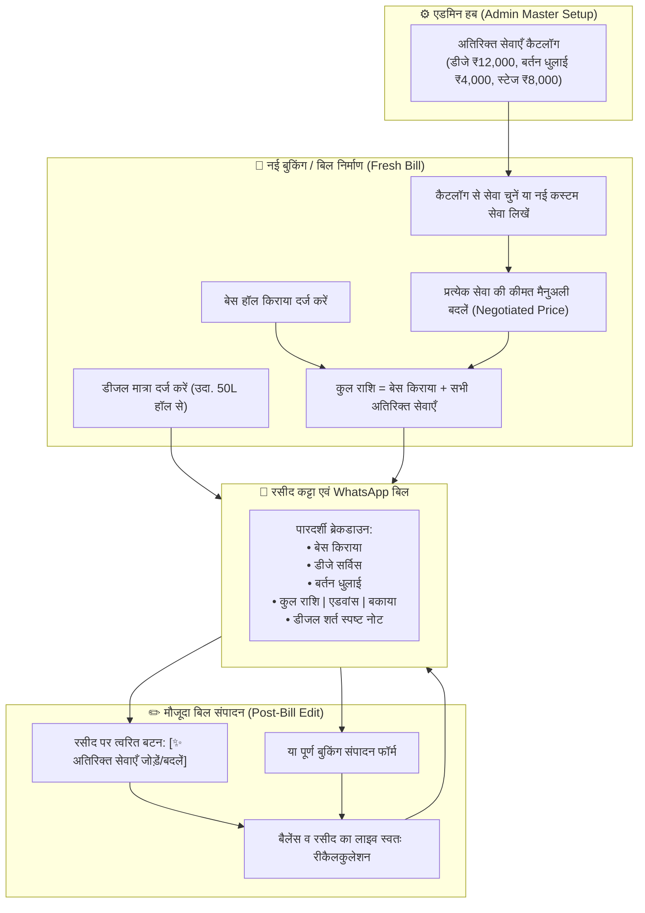

# 📋 प्रस्ताव एवं आर्किटेक्चर: अतिरिक्त सेवाएँ (Value Added Services) एवं डीजल मात्रा प्रबंधन
*(Comprehensive Technical Proposal & UI Blueprint for Verma Marriage Hall)*

> **दस्तावेज़ स्थिति:** यूज़र समीक्षा एवं सुझाव हेतु प्रस्तुत (Awaiting User Feedback & Approval)  
> **अंतिम संपादन:** 26 नवम्बर 2026  
> **लक्षित ऐप्लिकेशन:** वर्मा मैरिज हॉल (VMH) — वेब व Android APK  
> **प्रस्तावित वर्ज़न:** `v2.5.0`

---

## 🎯 1. पृष्ठभूमि एवं आवश्यकता (Executive Summary)

वर्मा मैरिज हॉल के दैनिक संचालन में मुख्य हॉल बुकिंग के अतिरिक्त कई विशेष सेवाएँ भी ग्राहकों को दी जाती हैं (जैसे: **डीजे साउंड, बर्तन धुलाई, अतिरिक्त स्टेज सजावट, कूलर व्यवस्था, फोटोग्राफी** आदि)। इसके साथ ही **जनरेटर में कितना लीटर डीजल हॉल द्वारा तय हुआ है** अथवा पार्टी लाएगी, यह बुकिंग का एक बहुत संवेदनशील और महत्वपूर्ण आर्थिक पहलू है।

### यूज़र की मुख्य आवश्यकताएँ:
1. **एडमिन में मास्टर कैटलॉग (Master VAS Catalog in Admin):** एडमिन पैनल में अतिरिक्त सेवाओं (VAS) की एक सूची रहे जहाँ डिफ़ॉल्ट दरें पहले से सेट की जा सकें।
2. **फ्रेश बिलिंग में चयन एवं मैनुअल मूल्य संपादन (Fresh Bill Creation & Dynamic Pricing):** नया बिल बनाते समय इन सेवाओं को आसानी से जोड़ा जा सके। सबसे महत्वपूर्ण बात: **हर सेवा का मूल्य बिल में आवश्यकतानुसार बदला जा सके** (क्योंकि हर ग्राहक के साथ मोल-भाव व आवश्यकता अलग होती है)।
3. **बिल बनने के बाद भी जोड़ना/हटाना/संशोधित करना (Post-Bill Modification):** यदि बिल पहले बन चुका है, और बाद में ग्राहक ने डीजे या बर्तन धुलाई की मांग की, तो बिल में कभी भी नई सेवा जोड़ी जा सके या मौजूदा सेवा की कीमत सुधारी जा सके।
4. **डीजल की मात्रा (Diesel Quantity in Liters):** कितने लीटर डीजल पर हॉल तय हुआ है (उदा. 50 लीटर, 80 लीटर, या 0 / पार्टी का), इसे स्पष्ट रूप से दर्ज और कभी भी संशोधित किया जा सके।
5. **रसीद कट्टा व कुल बिल में पारदर्शी योग (Receipt Slip Transparency):** मुख्य रसीद और एक्सपोर्ट बिल में बेस हॉल किराया, प्रत्येक अतिरिक्त सेवा की राशि, कुल तय राशि, जमा एडवांस और बकाया राशि का साफ़-साफ़ विवरण दिखे।

---

## 🏗️ 2. सिस्टम आर्किटेक्चर एवं डेटा फ्लो (Architecture & Flow)



---

## 🎨 3. यूजर इंटरफ़ेस (UI) मॉकअप्स एवं डिज़ाइन ब्लूप्रिंट

### (क) एडमिन हब: अतिरिक्त सेवाएँ मास्टर (Admin Subview: `vas`)

एडमिन सेटिंग्स में एक नया कार्ड **"✨ अतिरिक्त सेवाएँ एवं दर सूची (Value Added Services)"** जोड़ा जाएगा।

```text
┌────────────────────────────────────────────────────────────────────────┐
│ ⚙️ एडमिन सेटिंग्स ➔ अतिरिक्त सेवाएँ मास्टर (Value Added Services)        │
├────────────────────────────────────────────────────────────────────────┤
│ [➕ नई डिफ़ॉल्ट सेवा जोड़ें]                                            │
│                                                                        │
│ ┌────────────────────────────────────────────────────────────────────┐ │
│ │ 🎧 डीजे साउंड एवं लाइट सर्विस                                      │ │
│ │ डिफ़ॉल्ट दर: ₹ 12,000 | स्थिति: ✅ सक्रिय                           │ │
│ │ [✏️ संपादित करें]  [🗑️ हटाएं]                                      │ │
│ ├────────────────────────────────────────────────────────────────────┤ │
│ │ 🍽️ बर्तन धुलाई एवं सफाई सेवा                                      │ │
│ │ डिफ़ॉल्ट दर: ₹ 4,000  | स्थिति: ✅ सक्रिय                           │ │
│ │ [✏️ संपादित करें]  [🗑️ हटाएं]                                      │ │
│ ├────────────────────────────────────────────────────────────────────┤ │
│ │ 🎭 स्पेशल स्टेज व फ्लॉवर डेकोरेशन                                  │ │
│ │ डिफ़ॉल्ट दर: ₹ 8,000  | स्थिति: ✅ सक्रिय                           │ │
│ │ [✏️ संपादित करें]  [🗑️ हटाएं]                                      │ │
│ ├────────────────────────────────────────────────────────────────────┤ │
│ │ 🌬️ जम्बो कूलर / फॉग मिस्ट व्यवस्था                                  │ │
│ │ डिफ़ॉल्ट दर: ₹ 3,000  | स्थिति: ✅ सक्रिय                           │ │
│ │ [✏️ संपादित करें]  [🗑️ हटाएं]                                      │ │
│ └────────────────────────────────────────────────────────────────────┘ │
└────────────────────────────────────────────────────────────────────────┘
```

---

### (ख) नई बुकिंग फॉर्म: अतिरिक्त सेवाएँ एवं डीजल सेक्शन (Booking Form)

बुकिंग फॉर्म में किराया सेक्शन के साथ अतिरिक्त सेवाओं का इंटरएक्टिव बॉक्स और डीजल मात्रा का स्पष्ट इनपुट रहेगा:

```text
┌────────────────────────────────────────────────────────────────────────┐
│ 💰 किराया, अतिरिक्त सेवाएँ एवं पेमेंट मोड                              │
├────────────────────────────────────────────────────────────────────────┤
│ हॉल बेस किराया (Base Hall Rent ₹) *                                    │
│ [ 80000                                                    ]           │
│                                                                        │
│ ── ✨ अतिरिक्त सेवाएँ (Value Added Services) ───────────────────────── │
│ ┌────────────────────────────────────────────────────────────────────┐ │
│ │ [✓] 🎧 डीजे साउंड सर्विस       दर (₹): [ 10000        ]  [🗑️ हटाएं]│ │
│ │     (कैटलॉग दर ₹12,000 थी, ग्राहक से ₹10,000 में तय हुआ)           │ │
│ ├────────────────────────────────────────────────────────────────────┤ │
│ │ [✓] 🍽️ बर्तन धुलाई सेवा         दर (₹): [ 4000         ]  [🗑️ हटाएं]│ │
│ └────────────────────────────────────────────────────────────────────┘ │
│                                                                        │
│ [➕ कैटलॉग से सेवा जोड़ें ▼]   [➕ अन्य कस्टम सेवा लिखें]               │
│                                                                        │
│ अतिरिक्त सेवाओं का कुल योग: ₹ 14,000                                   │
│ ────────────────────────────────────────────────────────────────────── │
│ 📊 कुल तय बिल राशि (Net Total):  ₹ 94,000 (हॉल ₹80k + सेवाएँ ₹14k)    │
│ ────────────────────────────────────────────────────────────────────── │
│ जमा एडवांस (Advance ₹) *                                               │
│ [ 25000                                                    ]           │
│                                                                        │
│ ┌────────────────────────────────────────────────────────────────────┐ │
│ │ बकाया राशि (Balance Due):                         ₹ 69,000         │ │
│ └────────────────────────────────────────────────────────────────────┘ │
│                                                                        │
│ ── ⛽ जनरेटर डीजल व्यवस्था (Generator Diesel Agreement) ─────────────── │
│ डीजल व्यवस्था प्रकार:                                                  │
│ (•) 🏛️ हॉल द्वारा तय मात्रा शामिल     ( ) 👥 पूर्णतः पार्टी/ग्राहक द्वारा │
│                                                                        │
│ तय डीजल मात्रा (Quantity in Liters):                                   │
│ [ 50 ] लीटर (Liters)                                                   │
│ 📝 रसीद नोट: "हॉल द्वारा 50 लीटर डीजल दिया जाएगा; अतिरिक्त खपत पार्टी" │
└────────────────────────────────────────────────────────────────────────┘
```

---

### (ग) बिल बनने के बाद भी जोड़ना/संपादित करना (Post-Bill Modification)

यदि बिल पहले से बन चुका है और रसीद स्क्रीन खुली है, तो ग्राहक की नई मांग पर त्वरित कार्रवाई के लिए **2 रास्ते** उपलब्ध रहेंगे:

1. **रास्ता 1: रसीद स्क्रीन पर डायरेक्ट त्वरित बटन `[✨ अतिरिक्त सेवाएँ प्रबंधित करें]`:**
   - रसीद स्क्रीन पर एक सुंदर बटन होगा।
   - इस पर क्लिक करते ही एक कॉम्पैक्ट मोडल खुलेगा जहाँ आप नई सेवा जोड़ सकते हैं, या मौजूदा सेवा की कीमत बदल सकते हैं, या हटा सकते हैं।
   - 'सेव करें' दबाते ही रसीद का कुल बिल और बकाया राशि बिना पेज रीलोड किए तुरंत अपडेट हो जाएगी।

2. **रास्ता 2: पूर्ण बुकिंग संपादन (Full Edit Booking):**
   - बुकिंग संपादन फॉर्म में जाकर बेस किराया, सभी अतिरिक्त सेवाएँ, एडवांस, किस्तों का इतिहास, और डीजल की मात्रा सब कुछ पूरी तरह बदला जा सकता है।

---

### (घ) रसीद कट्टा एवं डिजिटल बिल (Receipt Slip Breakdown)

रसीद कट्टा (Print/WhatsApp Image) पर यह अत्यधिक पेशेवर एवं पारदर्शी दिखेगा ताकि ग्राहक और हॉल दोनों के पास स्पष्ट प्रमाण रहे:

```text
┌────────────────────────────────────────────────────────────────────────┐
│                    🏛️ वर्मा मैरिज हॉल एवं लॉन                          │
│                   ग्राम असनहरा, बस्ती (उ.प्र.)                         │
│                    मो. 9450371421, 8887802897                          │
├────────────────────────────────────────────────────────────────────────┤
│ रसीद सं: VMH-2026-11-042                     दिनांक: 26/11/2026        │
│ श्रीमान्/पार्टी: श्री रामेश्वर वर्मा          समारोह: शुभ विवाह         │
│ कार्यक्रम दिनांक: 15/12/2026                  स्लॉट: पूरा दिन (24 घंटे) │
├────────────────────────────────────────────────────────────────────────┤
│ विवरण (PARTICULARS)                                    रकम (AMOUNT ₹)  │
├────────────────────────────────────────────────────────────────────────┤
│ 1. मुख्य हॉल बेस किराया (Base Hall Rent)               ₹ 80,000        │
│ 2. [+] 🎧 डीजे साउंड एवं लाइट सर्विस                   ₹ 10,000        │
│ 3. [+] 🍽️ बर्तन धुलाई एवं सफाई सेवा                   ₹  4,000        │
├────────────────────────────────────────────────────────────────────────┤
│ कुल तय राशि (Total Agreed Amount)                      ₹ 94,000        │
│ जमा एडवांस (Advance Received - Cash)                   ₹ 25,000        │
│ ────────────────────────────────────────────────────────────────────── │
│ शेष बकाया राशि (Balance Due)                           ₹ 69,000        │
├────────────────────────────────────────────────────────────────────────┤
│ ⛽ जनरेटर डीजल व्यवस्था:                                               │
│ हॉल प्रबंधन द्वारा 50 लीटर डीजल प्रदान किया जाएगा।                     │
│ (50 लीटर से अधिक खपत होने पर अतिरिक्त डीजल पार्टी द्वारा वहन किया जाएगा) │
└────────────────────────────────────────────────────────────────────────┘
```

---

## 🗄️ 4. डेटा स्कीमा व बैकवर्ड कम्पैटिबिलिटी (Data Model)

पुरानी बुकिंग्स को बिना किसी त्रुटि के चलाने के लिए बैकवर्ड कम्पैटिबिलिटी सुनिश्चित की गई है:

```typescript
interface ValueAddedServiceItem {
  id: string;              // e.g. "vas_dj" or "vas_custom_1732612345"
  title: string;           // e.g. "डीजे साउंड सर्विस"
  amount: number;          // e.g. 10000 (manually edited/negotiated)
  catalogDefault?: number; // e.g. 12000 (reference only)
  notes?: string;          // optional remarks
}

interface BookingRecord {
  // Existing fields...
  id: string;
  partyName: string;
  totalRent: number;       // Now represents NET TOTAL (baseRent + sum of vasItems)
  baseRent?: number;       // Base Hall Rent (defaults to totalRent if vasItems empty)
  advancePaid: number;
  balanceDue: number;
  
  // NEW VALUE ADDED SERVICES ARRAY:
  vasItems: ValueAddedServiceItem[]; 
  
  // NEW DIESEL SPECIFICATION:
  dieselConfig: {
    mode: 'included_by_hall' | 'party_provides' | 'not_required';
    liters: number;        // e.g. 50
    termsText?: string;    // Custom wording if modified
  };
}
```

> [!NOTE]
> **पुरानी बुकिंग्स पर शून्य प्रभाव:** यदि किसी पुरानी बुकिंग में `vasItems` नहीं है, तो सिस्टम स्वतः `vasItems = []` और `baseRent = totalRent` मान लेगा। इससे पहले से दर्ज 100% बुकिंग्स सुरक्षित और सही रहेंगी।

---

## ⚡ 5. तकनीकी खूबियाँ (Key Technical Highlights)

1. **पर्सन-टू-पर्सन कस्टमाइज़ेशन (Individual Price Overrides):**
   - जब आप कैटलॉग से कोई सेवा चुनते हैं, तो उसकी डिफ़ॉल्ट दर केवल सहायता के लिए आती है। 
   - आप उसी समय बॉक्स में नया भाव टाइप कर सकते हैं (उदा. ₹12,000 को काटकर ₹10,000 या ₹14,000 कर सकते हैं)।
2. **कस्टम सेवा ऑन-द-फ्लाई (One-Off Custom Services):**
   - यदि कोई ऐसी सेवा है जो कैटलॉग में नहीं है (उदा. "हलवाई हेतु अतिरिक्त भट्टी व गैस सिलेंडर"), तो आप बिना एडमिन में जाए सीधे बिल में सेवा का नाम और रुपया लिखकर जोड़ सकते हैं।
3. **लाइव बैलेंस व डायनामिक UPI QR ऑटो-सिंक:**
   - जैसे ही आप कोई अतिरिक्त सेवा जोड़ेंगे या उसका भाव बदलेंगे, तुरंत कुल बिल राशि, बकाया राशि, और भुगतान हेतु डायनामिक UPI QR कोड का रुपया लाइव अपडेट हो जाएगा।
4. **डीजल कंडीशन का डायनामिक जनरेशन:**
   - जब आप 50 लीटर लिखेंगे, तो रसीद की शर्तों में स्वतः लिख जाएगा: *"हॉल द्वारा 50 लीटर डीजल प्रदान किया जाएगा..."*।
   - यदि 'पार्टी द्वारा' चुनेंगे, तो स्वतः लिख जाएगा: *"जनरेटर हेतु सम्पूर्ण डीजल ग्राहक/पार्टी द्वारा उपलब्ध कराया जाएगा।"*

---

## ❓ 6. यूज़र समीक्षा एवं निर्णय बिंदु (Decisions & Feedback Needed)

कृपया इस प्रस्ताव की समीक्षा करें और पुष्टि करें:

1. **कैटलॉग डिफ़ॉल्ट सेवाएँ:** क्या शुरुआत के लिए निम्नलिखित 4 सेवाएँ सही हैं?
   - डीजे साउंड एवं लाइट सर्विस
   - बर्तन धुलाई एवं सफाई सेवा
   - स्पेशल स्टेज एवं फ्लॉवर सजावट
   - जम्बो कूलर / फॉग मिस्ट व्यवस्था
   *(आप अपनी पसंद से कोई अन्य सेवा भी जोड़ या हटवा सकते हैं)*
2. **डीजल डिफ़ॉल्ट मान:** क्या नए फॉर्म में डिफ़ॉल्ट रूप से **"हॉल द्वारा शामिल (उदा. 50 या 60 लीटर)"** रखना है या **"पार्टी द्वारा उपलब्ध कराया जाएगा"** डिफ़ॉल्ट रखना है?
3. **रसीद लेआउट:** क्या रसीद पर अतिरिक्त सेवाओं को अलग पंक्तियों में जोड़कर दिखाना जैसा ऊपर मॉकअप में दिखाया गया है, आपकी पसंद के अनुकूल है?

---
*दस्तावेज़ संपादन: Google Antigravity AI | 26 नवम्बर 2026*
