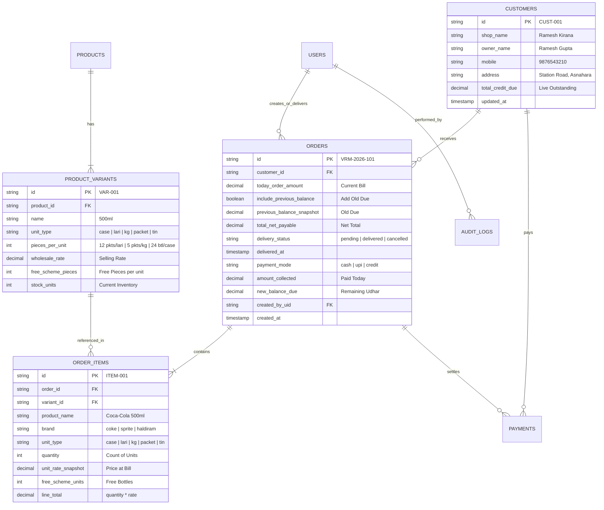
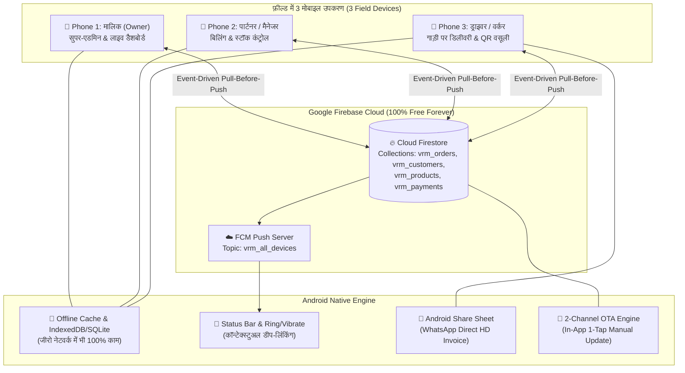

# 🥤🍿 वर्मा राइस मिल (कोका-कोला एवं हल्दीराम नमकीन डिस्ट्रीब्यूटर) — मोबाइल ऐप मास्टर स्पेसिफिकेशन एवं आर्किटेक्चर ब्लूप्रिंट
*(Standalone Commercial FMCG Billing & Distribution System Specification Document)*

> **दस्तावेज़ का उद्देश्य (Single Source of Truth):**  
> यह दस्तावेज़ **वर्मा राइस मिल — कोका-कोला एवं हल्दीराम नमकीन डिस्ट्रीब्यूटर (Verma Rice Mill - Coca-Cola & Haldirams Distributor)** के स्वतंत्र, स्टैंडअलोन मोबाइल बिलिंग, डिलीवरी एवं उधारी प्रबंधन एप्लिकेशन का आधिकारिक उत्पाद विनिर्देश (PRD), डेटाबेस स्कीमा और आर्किटेक्चर ब्लूप्रिंट है। इसमें आपके पूर्व रिपॉजिटरी (`amitkrak83/DOMS`) से निकाली गई सभी कोर कार्यप्रणालियां (स्कीम इंजन, उधारी लेजर, डायनामिक QR, 3-डिवाइस सिंक, WhatsApp इनवॉइस शेयरिंग) और वर्मा मैरिज हॉल ऐप के दौरान तय किए गए सभी सिद्ध UI/UX सिद्धांत पूर्णतः समाहित हैं।  
> **दस्तावेज़ स्थान:** `C:\Users\Sushil Kumar\.gemini\antigravity\brain\71613302-7f86-4f60-b886-d6e64cdaabf1\VERMA_COLD_DRINK_HALDIRAM_APP_SPECIFICATION.md`  
> **इंटरएक्टिव स्क्रीन सिमुलेटर (HTML Preview):** `C:\Users\Sushil Kumar\.gemini\antigravity\brain\71613302-7f86-4f60-b886-d6e64cdaabf1\verma_rice_mill_fmcg_screens_preview.html`

---

## 📑 विषय-सूची (Table of Contents)
1. [कार्यकारी सारांश एवं दृष्टि (Executive Summary & Vision)](#1-कार्यकारी-सारांश-एवं-दृष्टि)
2. [व्यापार प्रोफ़ाइल एवं बुनियादी संदर्भ (Business Profile & Location)](#2-व्यापार-प्रोफ़ाइल-एवं-बुनियादी-संदर्भ)
3. [उपयोगकर्ता रोल संरचना (3-Roles Hierarchy)](#3-उपयोगकर्ता-रोल-संरचना)
4. [उत्पाद कैटलॉग, पैकेजिंग एवं बिक्री इकाइयां (Product Lines & Packaging Units)](#4-उत्पाद-कैटलॉग-पैकेजिंग-एवं-बिक्री-इकाइयां)
5. [DOMS से विरासत में मिले कोर फीचर्स एवं बिज़नेस लॉजिक (DOMS Core Features)](#5-doms-से-विरासत-में-मिले-कोर-फीचर्स-एवं-बिज़नेस-लॉजिक)
6. [हल्दीराम एवं कोल्ड ड्रिंक का एकीकृत बिलिंग नियम (Unified Single Billing Rule)](#6-हल्दीराम-एवं-कोल्ड-ड्रिंक-का-एकीकृत-बिलिंग-नियम)
7. [दोहरे बिलिंग मोड्स: POS ग्रिड बनाम नॉर्मल फॉर्म (Dual Billing Modes)](#7-दोहरे-बिलिंग-मोड्स-pos-ग्रिड-बनाम-नॉर्मल-फॉर्म)
8. [आपकी पसंद-नापसंद एवं सिद्ध UI/UX सिद्धांत (Learned Preferences & UI/UX Principles)](#8-आपकी-पसंद-नापसंद-एवं-सिद्ध-uiux-सिद्धांत)
9. [स्क्रीन-बाय-स्क्रीन विस्तृत वायरफ्रेम ब्लूप्रिंट (All UI Screens Layout)](#9-स्क्रीन-बाय-स्क्रीन-विस्तृत-वायरफ्रेम-ब्लूप्रिंट)
10. [डेटाबेस स्कीमा एवं फ़ील्ड संरचना (Database Schema & Collections)](#10-डेटाबेस-स्कीमा-एवं-फ़ील्ड-संरचना)
11. [सिस्टम आर्किटेक्चर एवं मल्टी-डिवाइस सिंक (Technical Architecture)](#11-सिस्टम-आर्किटेक्चर-एवं-मल्टी-डिवाइस-सिंक)
12. [नए चैट हेतु रेडी-टू-पेस्ट किक-ऑफ प्रॉम्प्ट (Ready-to-Paste Kickoff Prompt)](#12-नए-चैट-हेतु-रेडी-टू-पेस्ट-किक-ऑफ-प्रॉम्प्ट)

---

## 1. कार्यकारी सारांश एवं दृष्टि (Executive Summary & Vision)

* **पूर्ण पृथक्करण (100% Independent Standalone App):** यह ऐप वर्मा मैरिज हॉल से 100% अलग होगा। इसका अपना पैकेज आईडी (उदा. `com.vermaricemill.agency`), अपना स्वतंत्र डेटाबेस (`vrm_orders`, `vrm_customers`, `vrm_products`) और अपनी स्वतंत्र FCM नोटिफिकेशन पाइपलाइन होगी।
* **उद्देश्य:** ग्रामीण व कस्बाई किराना दुकानों, ढाबों और टी-स्टॉलों पर कोल्ड ड्रिंक पेटियों (Coca-Cola, Sprite, Maaza, आदि) और हल्दीराम उत्पादों (भुजिया, नमकीन, मिठाई टिन, लरी) की गाड़ी से डिलीवरी, ऑन-द-स्पॉट बिलिंग, स्कीम छूट, उधारी लेजर (खाता) और नकद/UPI वसूली का अत्यंत तीव्र व सरल संचालन।
* **सीधे दुकानदार पर बिलिंग (No Route/Beat Dependency):** किसी रूट या बीट का कोई बंधन नहीं होगा; डिलीवरी और बिलिंग सीधे दुकानदार / ग्राहक के नाम से की जाएगी।
* **0 रुपये आजीवन लागत (Zero Recurring Cost):** Google Firebase Spark Plan के निःशुल्क टियर पर 100% संचालित।
* **ऑफलाइन-फर्स्ट क्षमता:** ग्रामीण क्षेत्रों में मोबाइल नेटवर्क न होने पर भी गाड़ी पर बिल बनेगा, डिलीवरी दर्ज होगी, पर्ची शेयर होगी, और नेटवर्क मिलते ही सभी 3 फ़ोन में स्वतः सिंक हो जाएगा।

---

## 2. व्यापार प्रोफ़ाइल एवं बुनियादी संदर्भ (Business Profile & Location)

* **फर्म का नाम (Firm Name):** **वर्मा राइस मिल (Verma Rice Mill)**
* **टैगलाइन / उप-शीर्षक (Tagline):** **कोका-कोला एवं हल्दीराम नमकीन डिस्ट्रीब्यूटर (Coca-Cola & Haldiram Namkeen Distributor)**
* **धार्मिक / शीर्ष स्लोगन:** `|| श्री गणेशाय नमः ||`
* **व्यापारिक पता:** ग्राम असनहरा बाजार, निकट अंकित धर्मकांटा, जिला बस्ती, उत्तर प्रदेश - 272181
* **संपर्क मोबाइल नंबर:** 9918802425, 9936435350
* **आधिकारिक डिजिटल पेमेंट UPI ID:** `9918802425@okbizicici` (मालिक एडमिन से कभी भी परिवर्तनीय)
* **मर्चेंट नाम:** वर्मा राइस मिल

---

## 3. उपयोगकर्ता रोल संरचना (3-Roles Hierarchy)

| क्र.सं. | रोल का नाम (Role) | व्यक्ति संख्या | अनुमतियां एवं अधिकार (Permissions) |
| :---: | :--- | :---: | :--- |
| 1 | 👑 **मालिक (Owner)** | 2 व्यक्ति *(मालिक एवं पार्टनर दोनों इसी रोल पर)* | **पूर्ण सुपर-एडमिन अधिकार:** पूरे बाजार की कुल उधारी देखना, सभी ऑर्डर्स/पेमेंट्स का ऑडिट लॉग, थोक रेट व फ्री स्कीम बदलना, नया प्रोडक्ट/वेरिएंट जोड़ना, ग्राहक की उधारी माफ/एडिट करना, पुराने बिल संशोधित/रद्द करना, तथा फर्म प्रोफ़ाइल व UPI ID बदलना। |
| 2 | 👔 **मैनेजर (Manager)** | 1 व्यक्ति | **प्रबंधन अधिकार:** गोदाम पर नया बिल काटना, गाड़ी पर माल लोड करना, नए ग्राहक जोड़ना, बाजार से नकद/UPI पेमेंट कलेक्ट करना, स्टॉक देखना। (मास्टर रेट बदलना या पुराने ऐतिहासिक रिकॉर्ड मिटाना वर्जित)। |
| 3 | 👷 **ड्राइवर / वर्कर (Driver/Staff)** | फ़ील्ड कर्मचारी | **फ़ील्ड ऑपरेशन अधिकार:** गाड़ी पर लोड आर्डर की दुकान पर डिलीवरी करना, मौके पर कैश/UPI QR से पैसे लेना, डिलीवरी मार्क करना, गलती से क्लिक होने पर **Undo** करना, और दुकानदार को WhatsApp पर्ची भेजना। |

---

## 4. उत्पाद कैटलॉग, पैकेजिंग एवं बिक्री इकाइयां (Product Lines & Packaging Units)

आपके द्वारा दिए गए सभी सामान और उनकी सटीक बिक्री इकाइयां निम्नवत हैं:

### 4.1 कोल्ड ड्रिंक एवं पानी (Beverages & Packaged Water)
* **ब्रांड्स सूची:**
  1. कोका-कोला (Coca-Cola)
  2. स्प्राइट (Sprite)
  3. थम्स अप (Thums Up)
  4. माज़ा (Maaza)
  5. लिम्का (Limca)
  6. फैंटा (Fanta)
  7. चार्ज (Charged)
  8. स्टिंग (Sting)
  9. किनले पानी (Kinley Packaged Water)
  10. हिमालय पानी (Himalayan Water)
* **पैकेजिंग साइज़:** 200ml, 250ml, 500ml, 600ml, 1.25L, 2.25L आदि।
* **बिक्री इकाई:** **पेटी (Cases)** एवं **बोतल (Bottles)**।
* **स्कीम नियम:** प्रति पेटी फ्री बोतल स्कीम (उदा. 500ml पेटी पर +1 बोतल फ्री)।

### 4.2 हल्दीराम नमकीन एवं चिप्स (Haldiram's Snacks & Chips)
* **MRP ₹5 नमकीन:** बिक्री इकाई = **लरी (Lari)** *(1 लरी में 12 पैकेट)*।
* **MRP ₹5 चिप्स:** बिक्री इकाई = **लरी (Lari)**।
* **MRP ₹10 चिप्स:** बिक्री इकाई = **पैकेट / लरी**।
* **MRP ₹20 नमकीन:** बिक्री इकाई = **लरी (Lari)**।
* **MRP ₹20 चिप्स:** बिक्री इकाई = **पैकेट / लरी**।
* **200 ग्राम नमकीन:** बिक्री इकाई = **किलो (Kg)** *(1 किलो में 5 पैकेट)*।
* **400 ग्राम नमकीन:** बिक्री इकाई = **पैकेट (Packets)**।

### 4.3 हल्दीराम मिठाई (Haldiram's Sweets)
* **सोन पापड़ी (Soan Papdi):** 250 ग्राम एवं 1 किलोग्राम (1 Kg)।
* **गुलाब जामुन (Gulab Jamun):** 1 किलोग्राम टिन (1 Kg Tin - 12 टिन/पेटी)।
* **रसगुल्ला (Rasgulla):** 1 किलोग्राम टिन (1 Kg Tin - 12 टिन/पेटी)।

### 4.4 बड़े पैक नमकीन (200g, 400g) की विभिन्न MRP एवं 1.14 / 1.16 मार्जिन कैलकुलेशन आर्किटेक्चर
एफएमसीजी एवं हल्दीराम डिस्ट्रीब्यूशन व्यापार में बड़े पैकेट (200g एवं 400g) के विभिन्न वेरियंट्स (जैसे भुजिया, मिक्सचर, नट क्रैकर, नवरत्न, मूंग दाल, आदि) की छपी हुई MRP एक समान नहीं होती, बल्कि हर वैरायटी की अलग MRP होती है (उदा. ₹60, ₹65, ₹70, ₹80, ₹85, ₹110, ₹120 आदि)।

* **थोक दर (Wholesale Selling Rate) निकालने का वास्तविक बिज़नेस फॉर्मूला:**
  डिस्ट्रीब्यूटर द्वारा दुकानदार को दी जाने वाली थोक दर (Billing Rate) MRP पर 1.14 (लगभग 12.3% रिटेलर मार्जिन) या 1.16 (लगभग 13.8% रिटेलर मार्जिन) का भाग (Division) देकर निकाली जाती है:
  $$\text{Wholesale Selling Rate (₹)} = \frac{\text{Printed MRP}}{1.14} \quad \text{या} \quad \frac{\text{Printed MRP}}{1.16}$$
  - *उदाहरण:* यदि 400g पैकेट पर छपी MRP ₹120 है:
    - 1.16 फैक्टर पर: $120 \div 1.16 = ₹103.448 \approx ₹103.50$ थोक दर।
    - 1.14 फैक्टर पर: $120 \div 1.14 = ₹105.263 \approx ₹105.00$ थोक दर।

* **इंजीनियरिंग डिज़ाइन निर्णय — "स्मार्ट ऑटो-मार्जिन असिस्ट" (Smart Auto-Margin Assist):**
  1. **डेटाबेस व बिलिंग की सरलता (Zero Complexity in Billing):**
     - बिलिंग स्क्रीन या डेटाबेस में कोई जटिल डायनामिक फॉर्मूला इंजन नहीं रखा जाएगा। डेटाबेस में सीधे उत्पाद का अंतिम `selling_rate` (₹ थोक दर) ही स्टोर होगा। इससे बिलिंग स्क्रीन (चाहे POS ग्रिड हो या नॉर्मल फॉर्म) 100% सुपरफास्ट, ऑफलाइन-रेडी और बिना किसी राउंडिंग विवाद के काम करेगी।
  2. **एडमिन प्रोडक्ट मास्टर में 1-टैप कैलकुलेटर हेल्पर (Frictionless Entry):**
     - जब एडमिन कोई नया प्रोडक्ट जोड़ेगा या किसी 200g/400g प्रोडक्ट की दर संशोधित करेगा, तो "थोक दर (₹)" बॉक्स के ठीक बगल में `[🧮 1.14 / 1.16 मार्जिन कैलकुलेटर]` बटन उपलब्ध रहेगा।
     - एडमिन केवल पैकेट पर छपी MRP दर्ज करेगा और `[1.16]` या `[1.14]` चिप पर टैप करेगा।
     - सिस्टम स्वतः फॉर्मूला लगाकर सटीक दर और व्यावहारिक निकटतम दर (Nearest ₹0.50) दिखा देगा और "दर लागू करें" पर क्लिक करते ही वह दर थोक दर वाले बॉक्स में भर जाएगी।
     - एडमिन अपनी इच्छानुसार उस दर को हाथ से थोड़ा बहुत बदल भी सकता है (Full Manual Override)।
  3. **फायदा:** एडमिन को अलग से मोबाइल कैलकुलेटर खोलने की जरूरत नहीं पड़ेगी, समय बचेगा और टाइपिंग/कैलकुलेशन की मानवीय गलतियां शून्य हो जाएंगी!

---

## 5. DOMS से विरासत में मिले कोर फीचर्स एवं बिज़नेस लॉजिक (DOMS Core Features)

पुराने रिपॉजिटरी (`amitkrak83/DOMS`) से निकाले गए और फ्रीज किए गए मुख्य बिज़नेस नियम:

### 5.1 ऑटोमैटिक स्कीम इंजन (Free Bottle Scheme Engine)
ग्रामीण थोक व्यापार में प्रति पेटी पर फ्री बोतलों की स्कीम चलती है:
* **फार्मूला:**
  $$\text{Free Bottles} = \text{Cases} \times \text{Free Bottles Per Case}$$
  $$\text{Total Bottles Delivered} = (\text{Cases} \times \text{Bottles Per Case}) + \text{Free Bottles}$$
  $$\text{Item Amount} = \text{Cases} \times \text{Price Per Case}$$
* **क्वांटिटी फॉर्मेटर (Smart Split Display):**
  - यदि किसी ऑर्डर में 28 फ्री बोतलें बनीं और पेटी 24 बोतल की है, तो बिल पर स्वतः लिखा आएगा: **`1 पेटी 4 बोतल फ्री`** (न कि केवल 28 बोतल)।
* **प्राइस स्नैपशॉट (`price_per_case_snapshot`):**
  - बिल बनते समय उस समय का रेट और स्कीम बिल में फ्रीज (Snapshot) हो जाती है। भविष्य में मास्टर में रेट बदलने पर पुराने बिलों का हिसाब कभी नहीं बिगड़ता।

### 5.2 मल्टी-मोड स्प्लिट पेमेंट व ऑटोमैटिक उधारी (Auto-Udhar Ledger)
डिलीवरी के समय भुगतान लेने के 3 विकल्प:
1. `💵 नकद (Cash)`
2. `📲 ऑनलाइन UPI QR`: स्क्रीन पर डायनामिक QR कोड बन जाएगा जिसमें दुकान की UPI ID और ठीक उतनी रकम पहले से भरी होगी। PhonePe / Google Pay / Paytm से 1 सेकंड में स्कैन।
3. `📝 उधारी (Credit / Khata)`: यदि ₹3,500 के बिल में दुकानदार ने ₹2,000 नकद/UPI दिया, तो शेष **₹1,500 स्वतः दुकानदार के उधारी खाते में जुड़ जाएगा**।
4. **क्विक 'FULL' बटन:** पूरी रकम एक क्लिक में भरने का शॉर्टकट ताकि बार-बार टाइप न करना पड़े।

### 5.3 ग्राहक खाता व उधारी लेजर (Khata & Dues Management)
* **शीर्ष कार्ड:** बाजार में कुल कितनी उधारी बाकी है (उदा. `🔴 ₹1,48,500 कुल बाजार उधारी`)।
* **ग्राहक कार्ड:** दुकानदार का नाम, पता, कुल आज तक का व्यापार, कुल जमा, और लाल रंग में बकाया (`🔴 ₹4,200 बाकी`)। चुकता होने पर हरा बैज (`🟢 सब चुकता`)।
* **ड्रिल-डाउन हिस्ट्री:** ग्राहक पर क्लिक करते ही उसकी पिछली सभी तारीखों के बिल, डिलीवरी स्थिति और जमा किए गए रुपयों का पूरा बहीखाता खुल जाता है।
* **सीधे कॉल व WhatsApp:** ग्राहक कार्ड से ही सीधे फ़ोन कॉल लगाने या WhatsApp पर तकादा मैसेज भेजने का 1-टैप बटन।

### 5.4 डिजिटल WhatsApp इनवॉइस शेयरिंग
* किसी थर्ड-पार्टी भारी PDF टूल के बिना सीधे मोबाइल स्क्रीन से **सुंदर, उच्च-क्वालिटी डिजिटल पर्ची (PNG/PDF)** तैयार होकर Android शेयर शीट के ज़रिए दुकानदार के WhatsApp पर शेयर हो जाती है।

### 5.5 डिलीवरी स्थिति ट्रैकिंग एवं अनडू (Delivery Workflow with Undo)
* `⏳ गाड़ी पर है (Pending)` $\rightarrow$ `✅ डिलीवर हो गया (Delivered)`।
* गलत क्लिक होने पर तुरंत स्क्रीन पर **"↩️ Undo / वापस पेंडिंग करें"** का विकल्प, जिससे गलती तुरंत सुधारी जा सके।

---

## 6. हल्दीराम एवं कोल्ड ड्रिंक का एकीकृत बिलिंग नियम (Unified Single Billing Rule)

ग्रामीण और कस्बाई क्षेत्र की व्यावहारिक जमीनी हकीकत:
* **एक ही इनवॉइस पर दोनों श्रेणियां:** किराना व जनरल स्टोर वाले कोल्ड ड्रिंक की पेटियों के साथ-साथ हल्दीराम की भुजिया, नमकीन के पैकेट, लरी और मिठाई के डिब्बे भी उसी गाड़ी से एक साथ मंगाते हैं।
* **कोई अलग बिल नहीं:** दोनों व्यापारों का बिल अलग-अलग फाड़ने के बजाय एक ही बिल **"वर्मा राइस मिल (कोका-कोला एवं हल्दीराम नमकीन डिस्ट्रीब्यूटर)"** के नाम से बनेगा।
* **बिल पर स्पष्ट विभाजन:**
  - कोल्ड ड्रिंक मद (पेटी, बोतल, फ्री स्कीम)
  - हल्दीराम मद (लरी, कार्टन, पैकेट, टिन)
  - **कुल योग = कोल्ड ड्रिंक राशि + हल्दीराम राशि**
  - **नेट देय राशि = पिछला बकाया (यदि जोड़ना हो) + आज का बिल - आज जमा**

---

## 7. दोहरे बिलिंग मोड्स: POS ग्रिड बनाम नॉर्मल फॉर्म (Dual Billing Modes)

आपके निर्देशानुसार ऐप में **दोनों प्रकार की बिलिंग** की सुविधा दी गई है:

1. **⚡ POS कैटलॉग ग्रिड मोड (Fast Touch Ordering):**
   - **बाएं वर्टिकल ब्रांड रेल:** `All`, `Coca-Cola`, `Sprite`, `Thums Up`, `Maaza`, `Sting/Charge`, `पानी (Kinley/Himalayan)`, `हल्दीराम लरी`, `नमकीन (Kg)`, `मिठाई टिन`।
   - **दाएं वेरिएंट ग्रिड:** चुने गए ब्रांड के सभी उपलब्ध साइज़/वेरिएंट्स।
   - प्रत्येक कार्ड पर `[-] [संख्या] [+]` बटन द्वारा गाड़ी पर चलते-चलते 1-टैप में माल जोड़ना।
   - नीचे फ्लोटिंग स्टिकी कार्ट बार: `🛒 3 सामान चुनी गई • कुल ₹3,890 [पर्ची बनाएं →]`।

2. **📝 नॉर्मल / स्टेप-बाय-स्टेप फॉर्म मोड:**
   - पारंपरिक विज़ार्ड: दुकानदार का नाम $\rightarrow$ ड्रॉपडाउन से प्रोडक्ट चुनें $\rightarrow$ पेटी/लरी/किलो संख्या डालें $\rightarrow$ `➕ बिल में जोड़ें` $\rightarrow$ रिव्यू करें एवं पर्ची बनाएं।

---

## 8. आपकी पसंद-नापसंद एवं सिद्ध UI/UX सिद्धांत (Learned Preferences & UI/UX Principles)

1. **अंगूठे के अनुकूल बड़े टैक्टाइल बटन (Big Touch Targets):** न्यूनतम 48px से 56px ऊंचाई। वाहन चलाते या सामान उठाते समय भी गलत क्लिक न हो (`btn-tactile` एक्टिव स्केल इफ़ेक्ट के साथ)।
2. **सॉलिड रेड क्रॉस (✕) बटन अंदर (Inside-Input Solid Red Clear Button):** इनपुट बॉक्स जब खाली हो, तो **शून्य वाइट पैच** (`display: none;`)। टाइप करते ही अंदर सॉलिड लाल गोला (`bg-rose-600`) और वाइट '✕' दिखेगा।
3. **वॉइस माइक (🎙️ बोलें) व ऑटो-अपेंड:** दुकानदार का नाम या टिप्पणी लिखते समय हिंदी में बोलकर टाइप करने की सुविधा और पुराना टेक्स्ट मिटे बिना आगे जुड़ना (Append Mode)।
4. **मोबाइल नंबर 10-अंक सीमा:** 10 अंक से ज्यादा टाइप या वॉइस इनपुट होने पर अतिरिक्त अंक स्वतः कट जाएंगे।
5. **सेल्फ़-नोटिफिकेशन म्यूट (Self-Notification Suppression):** जिस फ़ोन से ऑर्डर या पेमेंट दर्ज होगी, उस फ़ोन पर अपनी ही बीप या बजर नहीं बजेगा। केवल बाकी 2 फ़ोन पर अलर्ट जाएगा।
6. **2-फ़ोन / 3-फ़ोन लाइव अलर्ट कवरेज:** नया ऑर्डर बनते ही, डिलीवरी होने पर, पेमेंट मिलते ही या उधारी दर्ज होते ही बाकी फ़ोन्स पर तुरंत साउंड, वाइब्रेशन और स्टेटस बार नोटिफिकेशन।
7. **कॉन्टेक्स्टुअल डीप-लिंकिंग:** नोटिफिकेशन पर टैप करते ही सीधे उसी ऑर्डर या उसी ग्राहक के खाते पर पहुँचना।
8. **डायनामिक वर्जनिंग व इन-ऐप OTA अपडेट इंजन:** नया अपडेट आने पर ऐप बिना बताए अचानक बंद नहीं होगा; होम स्क्रीन पर स्पष्ट **"⬇️ अभी नया अपडेट इंस्टॉल करें"** का बैनर दिखेगा।

---

## 9. स्क्रीन-बाय-स्क्रीन विस्तृत वायरफ्रेम ब्लूप्रिंट (All UI Screens Layout)

### स्क्रीन 1: मुख्य डैशबोर्ड (Home Dashboard)
```
+-------------------------------------------------------+
|  🥤 वर्मा राइस मिल                                     |
|  कोका-कोला एवं हल्दीराम नमकीन डिस्ट्रीब्यूटर  [🟢 ऑनलाइन]|
|  ग्राम असनहरा बाजार, बस्ती • 👑 मालिक           🔔 (2) |
+-------------------------------------------------------+
|  आज का व्यापार सारांश (Today's Business Summary)      |
|  +------------------------+  +----------------------+  |
|  |  📦 आज की कुल डिलीवरी  |  |  💰 आज की नकद/UPI    |  |
|  |   32 पेटी • 14 लरी     |  |      ₹28,450         |  |
|  +------------------------+  +----------------------+  |
|  +------------------------+  +----------------------+  |
|  |  ⏳ गाड़ी पर (बाकी)    |  |  🔴 बाजार कुल उधारी  |  |
|  |       4 ऑर्डर          |  |     ₹1,48,500        |  |
|  +------------------------+  +----------------------+  |
+-------------------------------------------------------+
|  त्वरित कार्य (Quick Action Buttons):                  |
|  [ ⚡ नया POS बिल (1-टैप) ]   [ 📝 नॉर्मल बिलिंग फॉर्म ]|
+-------------------------------------------------------+
|  ताज़ा डिलीवरी ऑर्डर्स (Live Feed):                    |
|                                                       |
|  [⏳] रमेश किराना स्टोर (स्टेशन रोड)                  |
|       6 पेटी (कोक, स्प्राइट) + 4 लरी भुजिया          |
|       ₹4,200  •  [ ⏳ गाड़ी पर है ] 10 मिनट पहले (रामू)|
|  ---------------------------------------------------  |
|  [✅] गुप्ता जनरल स्टोर (असनहरा चौराहा)                |
|       10 पेटी माज़ा + 2 टिन रसगुल्ला                  |
|       ₹6,800  •  [ 🟢 डिलीवर हुआ ]   45 मिनट पहले     |
+-------------------------------------------------------+
|  [ 🏠 होम ]  [ ⚡ POS ]  [ 🚚 डिलीवरी ]  [ 📖 खाता ]   |
+-------------------------------------------------------+
```

---

### स्क्रीन 2: POS कैटलॉग ग्रिड बिलिंग (POS Screen: Rail + Grid)
```
+-------------------------------------------------------+
|  ← नया बिल बनाएं                           [नॉर्मल →] |
+-------------------------------------------------------+
|  दुकानदार: [ 🔍 रमेश किराना स्टोर             🎙️ ]     |
|  पुराना बकाया: 🔴 ₹1,800  [✓] इस बिल में जोड़ें       |
+-------------------------------------------------------+
|  ब्रांड चुनें (बाएं रेल) | प्रोडक्ट वेरिएंट ग्रिड (दाएं) |
|  [ सभी सामान         *] | [ Coca-Cola 500ml (24 btl)  ] |
|  [ Coca-Cola          ] |   ₹480/पेटी • 🎁 +1 बोतल फ्री |
|  [ Sprite             ] |   [ - ]   [ 5 पेटी ]   [ + ]  |
|  [ Maaza              ] | ----------------------------- |
|  [ Thums Up           ] | [ ₹5 भुजिया लरी (12 pkts)   ] |
|  [ हल्दीराम लरी       ] |   ₹50/लरी (MRP ₹60)           |
|  [ नमकीन (Kg)         ] |   [ - ]   [ 4 लरी ]    [ + ]  |
|  [ मिठाई टिन          ] | ----------------------------- |
|                         | [ रसगुल्ला 1Kg टिन          ] |
|                         |   ₹185/टिन • 12 टिन/पेटी      |
|                         |   [ - ]   [ 2 टिन ]    [ + ]  |
+-------------------------------------------------------+
|  🛒 3 सामान चयनित • कुल बिल: ₹3,890     [ पर्ची देखें → ]|
+-------------------------------------------------------+
```

---

### स्क्रीन 3: डिजिटल पर्ची एवं इनवॉइस (Digital Bill Slip)
```
+-------------------------------------------------------+
|  ← डिजिटल पर्ची (VRM-2026-108)             [← डैशबोर्ड]|
+-------------------------------------------------------+
|  || श्री गणेशाय नमः ||                                |
|  वर्मा राइस मिल                                       |
|  कोका-कोला एवं हल्दीराम नमकीन डिस्ट्रीब्यूटर          |
|  ग्राम असनहरा बाजार, निकट अंकित धर्मकांटा, बस्ती (उ.प्र.)|
|  मो.: 9918802425, 9936435350                          |
+-------------------------------------------------------+
|  दुकानदार: रमेश किराना स्टोर • मो: 9876543210        |
|  दिनांक: 26/11/2026 • पता: स्टेशन रोड, असनहरा         |
+-------------------------------------------------------+
|  सामान              मात्रा       स्कीम       रकम (₹)  |
|  • Coca-Cola 500ml  5 पेटी     +5 बोतल     ₹2,400     |
|  • Maaza 600ml      2 पेटी     +2 बोतल       ₹920     |
|  • ₹5 भुजिया लरी    4 लरी      —             ₹200     |
|  • रसगुल्ला 1Kg टिन 2 टिन      —             ₹370     |
|  ---------------------------------------------------  |
|  आज का सामान बिल :                          ₹3,890     |
|  (+) पिछला बकाया उधारी :                    ₹1,800     |
|  कुल देय धनराशि :                           ₹5,690     |
|  (-) आज नकद/UPI प्राप्त :                   ₹3,000     |
|  बाकी शेष उधारी (खाता) :                    ₹2,690     |
+-------------------------------------------------------+
|  [ 📷 UPI QR: 9918802425@okbizicici ]                 |
|  दुकानदार हस्ताक्षर         वर्मा राइस मिल (हस्ताक्षर)|
+-------------------------------------------------------+
|  [ 📲 WhatsApp पर्ची भेजें ]     [ 🖨️ प्रिंट / PDF ]   |
+-------------------------------------------------------+
```

---

## 10. डेटाबेस स्कीमा एवं फ़ील्ड संरचना (Database Schema & Collections)



---

## 11. सिस्टम आर्किटेक्चर एवं मल्टी-डिवाइस सिंक (Technical Architecture)



---

## 12. नए चैट हेतु रेडी-टू-पेस्ट किक-ऑफ प्रॉम्प्ट (Ready-to-Paste Kickoff Prompt)

```markdown
# 🚀 KICKOFF PROMPT: "वर्मा राइस मिल (कोका-कोला एवं हल्दीराम नमकीन डिस्ट्रीब्यूटर)" स्टैंडअलोन बिलिंग ऐप डेवलपमेंट

नमस्ते Antigravity! मुझे अपने थोक FMCG वितरण कारोबार के लिए एक स्टैंडअलोन, पूर्णतः स्वतंत्र Android मोबाइल बिलिंग एवं डिलीवरी ऐप का निर्माण शुरू करना है।

- **फर्म का नाम:** वर्मा राइस मिल (Verma Rice Mill)
- **टैगलाइन / उप-शीर्षक:** कोका-कोला एवं हल्दीराम नमकीन डिस्ट्रीब्यूटर (Coca-Cola & Haldiram Namkeen Distributor)
- **स्थान:** ग्राम असनहरा बाजार, निकट अंकित धर्मकांटा, जिला बस्ती (उ.प्र.) - 272181
- **संपर्क:** 9918802425, 9936435350 | **UPI ID:** 9918802425@okbizicici

यह ऐप मेरे पहले से चल रहे "वर्मा मैरिज हॉल" ऐप से 100% अलग होगा।

मेरे इस प्रोजेक्ट का संपूर्ण आधिकारिक मास्टर विनिर्देश (PRD), उत्पाद कैटलॉग, डेटाबेस स्कीमा, और इंटरएक्टिव स्क्रीन सिमुलेटर पहले से स्थानीय डिस्क पर तैयार और सहेजा हुआ है। कृपया सबसे पहले इन दोनों फाइलों को पूरा पढ़ें:
1. **मास्टर स्पेसिफिकेशन डॉक्यूमेंट (PRD):**
   👉 C:\Users\Sushil Kumar\.gemini\antigravity\brain\71613302-7f86-4f60-b886-d6e64cdaabf1\VERMA_COLD_DRINK_HALDIRAM_APP_SPECIFICATION.md
2. **इंटरएक्टिव स्क्रीन सिमुलेटर (HTML Preview):**
   👉 C:\Users\Sushil Kumar\.gemini\antigravity\brain\71613302-7f86-4f60-b886-d6e64cdaabf1\verma_rice_mill_fmcg_screens_preview.html

### मुख्य बिज़नेस नियम एवं उत्पाद सूची (Non-Negotiable Specs):
1. **सीधे दुकानदार पर बिलिंग (No Route/Beat):** कोई रूट या बीट का चयन नहीं होगा; सीधे दुकानदार के नाम से बिलिंग व खाता चलेगा।
2. **दोहरे बिलिंग मोड्स:** POS कैटलॉग ग्रिड मोड (ब्रांड रेल + वेरिएंट ग्रिड) एवं नॉर्मल स्टेप-बाय-स्टेप फॉर्म मोड दोनों उपलब्ध रहने चाहिए।
3. **सटीक उत्पाद कैटलॉग व बिक्री इकाइयां:**
   - **कोल्ड ड्रिंक व पानी:** कोका-कोला, स्प्राइट, थम्स अप, माज़ा, लिम्का, फैंटा, चार्ज, स्टिंग, किनले पानी, हिमालय पानी (पेटी व बोतल, प्रति पेटी फ्री बोतल स्कीम)।
   - **हल्दीराम नमकीन व चिप्स:**
     - MRP 5 नमकीन (लरी वाइज़, 1 लरी = 12 पैकेट)
     - MRP 5 चिप्स (लरी वाइज़)
     - MRP 10 चिप्स
     - MRP 20 नमकीन (लरी वाइज़)
     - MRP 20 चिप्स
     - 200 ग्राम नमकीन (किलो वाइज़, 1 किलो = 5 पैकेट)
     - 400 ग्राम नमकीन (पैकेट वाइज़)
   - **हल्दीराम मिठाई:** सोन पापड़ी (250 ग्राम एवं 1 किलोग्राम), गुलाब जामुन 1 किलो टिन, रसगुल्ला 1 किलो टिन।
4. **एकीकृत एकल बिल:** कोल्ड ड्रिंक और हल्दीराम दोनों उत्पाद एक ही इनवॉइस पर संयुक्त रूप से बिल होंगे।
5. **DOMS कोर लॉजिक:**
   - प्रति पेटी ऑटोमैटिक स्कीम कैलकुलेटर (स्मार्ट स्प्लिट: उदा. "1 पेटी 4 बोतल फ्री")।
   - प्राइस स्नैपशॉट।
   - स्प्लिट पेमेंट (नकद + डायनामिक UPI QR + बाकी बचा स्वतः उधारी खाते में)।
   - 1-क्लिक WhatsApp डिजिटल इनवॉइस शेयरिंग।
   - उधारी लेजर (Khata) और बाजार कुल उधारी ट्रैकर।
6. **3 फ़ोन्स रियल-टाइम सिंक & 0 रुपये खर्च:** Google Firebase Spark Free Plan पर मालिक, मैनेजर, और ड्राइवर (वर्कर) के 3 फ़ोन्स पर लाइव डेटा सिंक और पुश नोटिफिकेशन (सेल्फ़-नोटिफिकेशन म्यूट)।
7. **UI/UX प्राथमिकताएं:**
   - अंगूठे के अनुकूल बड़े बटन (48-56px)।
   - इनपुट बॉक्स खाली होने पर शून्य वाइट पैच, टाइप करने पर अंदर सॉलिड लाल '✕' क्लियर बटन।
   - हिंदी वॉइस माइक (🎙️ बोलें) इनपुट।
   - मोबाइल नंबर पर 10-अंक सीमा।
   - इन-ऐप OTA अपडेट इंजन (अपडेट आने पर '⬇️ अभी नया अपडेट इंस्टॉल करें' बैनर)।

कृपया उक्त मास्टर स्पेसिफिकेशन दस्तावेज़ और स्क्रीन सिमुलेटर को पढ़कर पुष्टि करें और बताएं कि हम पहले माइलस्टोन से कैसे शुरुआत करेंगे।
```

---
*(यह दस्तावेज़ आपके प्रोजेक्ट का स्थायी सिंगल सोर्स ऑफ ट्रुथ है)*
